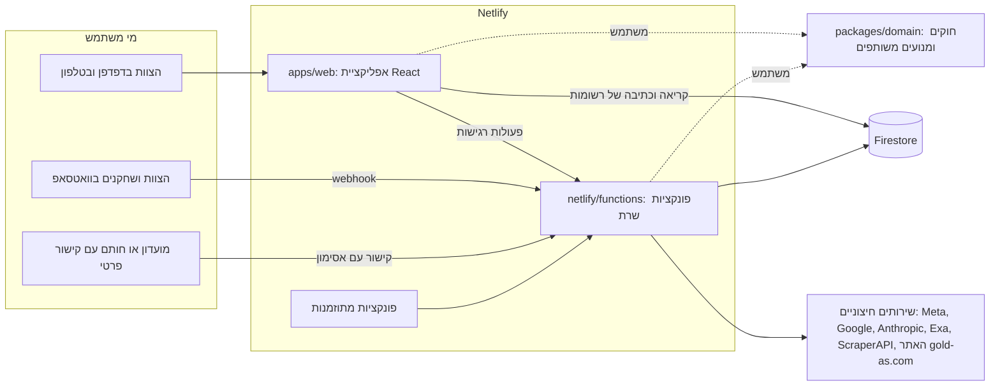

# ארכיטקטורת המערכת: Gold A&S CRM וגולדה

**מצב נכון ל-27.11.2026** (אחרי PR #83). זה הקובץ האחד שמתאר את המערכת כפי שהיא בנויה היום: מה יש בה, איפה כל דבר נמצא, ואיך החלקים מדברים זה עם זה.

**הקובץ הזה חייב להתעדכן בכל שינוי.** הבדיקה `node scripts/check-architecture.mjs` רצה בתוך `npm test` (ולכן גם ב-CI על כל PR) ומשווה את הרשימות שכאן לקוד עצמו. PR שמוסיף, מסיר או משנה שם של פונקציית שרת, מודול, מסך, נתיב, אוסף נתונים, משתנה סביבה או כלי של גולדה בלי לעדכן את הקובץ, נכשל ולא יכול להתמזג. הפרטים בסעיף [איך הקובץ נשאר מעודכן](#15-איך-הקובץ-נשאר-מעודכן).

קבצים אחים, כל אחד למטרה אחרת:

| קובץ | מה יש בו |
|---|---|
| `docs/architecture.md` (הקובץ הזה) | מה בנוי ואיך: מבנה, רכיבים, נתונים, זרימות |
| `docs/runbooks.md` | איך מתפעלים: מה לעשות כשמשהו נתקע, איך משחזרים, איך מחברים שירות |
| `docs/decisions.md` | למה: החלטות הארכיטקטורה (ADR) והנימוקים שלהן |
| `docs/golda-whatsapp.md` | החיבור של גולדה לוואטסאפ של Meta, שלב אחר שלב |
| `docs/ifa-browser-sync-task.md` | סנכרון הגיבוי של משחקי ההתאחדות מהדפדפן |

התוכנית המקורית של גרסה 3.0 (אושרה ב-12.10.2026) נמצאת במסמך המעוצב "Gold A&S 3.0". היא מתארת את היעד כפי שתוכנן; הקובץ הזה מתאר את מה שנבנה בפועל, כולל כל מה שנוסף מאז.

---

## 1. המערכת במבט אחד

מערכת ניהול של סוכנות כדורגל: שחקנים מיוצגים, מועמדים, מועדונים, אנשי קשר, דרישות של מועדונים, עסקאות וכספים, משחקים ואימונים, הסכמי ייצוג, ועוזרת בשם גולדה שעובדת בוואטסאפ ובתוך האפליקציה.

שלושה עקרונות שמחזיקים את המבנה:

1. **מקור אמת אחד לחוקים.** ההרשאות, השלבים, ההתראות, ההתאמות והחישובים הכספיים כתובים פעם אחת ב-`packages/domain`, והאפליקציה, השרת וגולדה משתמשים באותו קוד. לכן מה שהמסך מראה הוא בדיוק מה שהמייל והוואטסאפ אומרים.
2. **הכול רץ בשרת.** כל עבודה חוזרת (סנכרונים, גיבויים, תדריכים, התראות) היא פונקציה מתוזמנת ב-Netlify. שום דבר לא תלוי במחשב דולק. היוצא מן הכלל היחיד: בדיקת גיבוי יומית של משחקי ההתאחדות מהדפדפן, כגיבוי בלבד.
3. **ההרשאות נאכפות בקוד.** כל בדיקה עוברת דרך `can()` שבדומיין. קובץ `firestore.rules` לא משתנה ולא משמש לאכיפת תפקידים.

---

## 2. מבנה הקוד

מאגר אחד (monorepo, npm workspaces), פריסה אחת ב-Netlify.

| תיקייה | מה יש בה |
|---|---|
| `apps/web` | האפליקציה: React 18 עם Vite, עברית מימין לשמאל ואנגלית, ערכות יום ולילה, service worker. מסכים ב-`src/pages`, שכבת הנתונים ב-`src/data`, רכיבים ב-`src/components` |
| `packages/domain` | TypeScript משותף: סכמות, קבועים, הרשאות, שלבים ומנועים. נבנה לפני האפליקציה ולפני בדיקות השרת |
| `netlify/functions` | פונקציות השרת (CommonJS, Node 20). קובץ לכל פונקציה, והלוגיקה ב-`lib/` |
| `netlify/functions/lib/migrations` | הסבות נתונים ממוספרות, רצות פעם אחת אחרי פריסה (גיבוי קודם) |
| `scripts` | בדיקות ועזרים: `check-functions.mjs`, `check-architecture.mjs`, `restore-backup.mjs`, צילומי מסך למובייל ולמעטפת |
| `e2e` | בדיקות Playwright על האפליקציה הבנויה (`smoke.spec.js`, `highlights.spec.js`) |
| `apps/web/dev` | רתמת פיתוח לצילום מסכים בלי להתחבר לנתוני אמת |
| `docs` | הקובץ הזה ואחיו |

זרימת מסירה: ענף אחד, PR, תצוגה מקדימה של Netlify, מיזוג אחד (squash) ל-main, ופריסה לייצור. כל פריסה לייצור עולה 15 קרדיטים של Netlify, ולכן שינויים מקובצים למיזוג אחד. תצוגות מקדימות עובדות מול נתוני הייצור.

---

## 3. מסכים ונתיבים

### מסכים

<!-- count:pages -->26<!-- /count --> קובצי מסך ב-`apps/web/src/pages`.

<!-- inventory:pages -->
| מסך | מה הוא |
|---|---|
| `Home` | בית: היום (מה דורש פעולה, משחקים ואימונים) ולשונית תמונת מצב |
| `Snapshot` | תמונת מצב 2.0: לוח תרשימים עם סינון צולב, מגמות, משפך עסקאות, ציר חוזים, ייצוא ל-Excel, PDF והדפסה |
| `Players` | שחקנים מיוצגים |
| `Player360` | כרטיס שחקן מלא: פרטים, מסמכים, רשימת השלמה, משחקים, קישורים חיים, הסכם ייצוג, דוח חודשי |
| `Pipeline` | השוק: מועמדים, עם כניסות לפי גברים, נשים, נוער ויהודים בחו"ל (מסך אחד לכל הכניסות) |
| `Requirements` | דרישות של מועדונים, עם ההתאמות הטובות ביותר |
| `Deals` | עסקאות לפי שלבים, עם המיילים של כל עסקה |
| `Finance` | כספים: תשלומים, תזרים, איחורים. למנהל מערכת בלבד |
| `Clubs` | מועדונים כרשומות, עם המיילים של כל מועדון |
| `Contacts` | אנשי קשר, מפת הקשרים, והמיילים של כל איש קשר |
| `Calendar` | לוח שנה: משחקים, אימונים ופגישות |
| `Matches` | רשימת משחקים ונתוני שחקן למשחק |
| `TmWatch` | סקאוטינג: מעקב Transfermarkt אחרי שחקנים עם קשר ישראלי או יהודי בחו"ל |
| `Golda` | הצ'אט עם גולדה בתוך האפליקציה, כולל דירוג תשובות |
| `Tasks` | המשימות שלי |
| `Notifications` | התראות, אותן התראות שהפעמון סופר |
| `Social` | האינסטגרם של הסוכנות: נתונים יומיים ופוסטים |
| `RecycleBin` | סל מיחזור: שחזור רשומות שנמחקו |
| `Team` | צוות: משתמשים, תפקידים, מספרי וואטסאפ וערוצי התראה |
| `Admin` | מערכת: 11 לשוניות (ראו למטה) |
| `Migrations` | הסבות נתונים: תוכנית, הרצה ודוח |
| `DesignSystem` | דף מערכת העיצוב |
| `Login` | כניסה עם Google |
| `PlayerPage` | דף שחקן חי, ציבורי עם קישור פרטי |
| `SignPage` | דף חתימה על הסכם ייצוג, ציבורי עם קישור פרטי |
| `YouTubeUpload` | דף העלאת סרטון גדול מהטלפון ישר ליוטיוב, ציבורי עם קישור פרטי |
<!-- /inventory:pages -->

לשוניות מסך המערכת (`/admin/<לשונית>`): בריאות (health), מכסות (quotas), גיבויים (backups), יומן פעולות (audit), שגיאות (errors), וואטסאפ (whatsapp), יומן Google (calendar), יוטיוב (youtube), מיילים (mail), אתר (website), הסכמי ייצוג (agreements).

### נתיבים בתוך המעטפת

<!-- count:routes -->34<!-- /count --> נתיבים ב-`apps/web/src/App.jsx`. חלקם הפניות לנתיב החדש של אותו מסך.

<!-- inventory:routes -->
| אזור | נתיבים |
|---|---|
| בית | `/`, `/home`, `/home/:tab`, `/dashboard` (מפנה לתמונת מצב) |
| שחקנים | `/players`, `/players/:id` |
| שוק | `/market` (מפנה), `/market/prospects`, `/market/requirements`, `/market/deals`, `/finance`, `/requirements` (מפנה) |
| כניסות לשוק | `/pipeline/men`, `/pipeline/women`, `/pipeline/youth`, `/pipeline/jewish`, `/pipeline/jewish/tm-watch` (מפנה) |
| מועדונים | `/clubs`, `/clubs/:id`, `/contacts` |
| לוח שנה | `/calendar`, `/matches` |
| סקאוטינג | `/scouting` (מפנה), `/scouting/tm-watch` |
| גולדה | `/golda` |
| ניהול | `/tasks`, `/notifications`, `/social`, `/recycle`, `/team`, `/admin`, `/admin/:tab`, `/admin/design`, `/admin/migrations` |
<!-- /inventory:routes -->

כלל: יעד אחד הוא רכיב אחד. הכניסות לשוק הן נתיבים לאותו מסך `Pipeline`, לא מסכים נפרדים.

### דפים ציבוריים, מחוץ למעטפת

שלושה דפים נפתחים בלי כניסה, והאסימון שבקישור הוא המפתח: `/p/<token>` (דף שחקן חי, המסך `PlayerPage`), `/sign/<token>` (חתימה על הסכם, המסך `SignPage`) ו-`/yt/<token>` (העלאה ליוטיוב, המסך `YouTubeUpload`). מי שמחזיק קישור כזה רואה רק את הדף הזה, ואין לו שום גישה לשאר המערכת.

### שכבת הנתונים של האפליקציה

המסכים לא קוראים ל-Firestore ישירות אלא דרך המודולים האלה ב-`apps/web/src/data` (ועוד `lib/db.js` לרשומות הכלליות ולקבצים).

<!-- inventory:data -->
| מודול | תחום |
|---|---|
| `players` | שחקנים ומועמדים |
| `clubs` | מועדונים |
| `deals` | עסקאות ותשלומים |
| `interactions` | מגעים עם אנשי קשר |
| `meetings` | פגישות |
| `trainings` | אימונים |
| `completeness` | רשימת ההשלמה של תיק שחקן |
| `recycle` | סל המיחזור |
| `golda` | הצ'אט עם גולדה, דירוגים ובדיקת התמלול |
| `admin` | מסך המערכת: עבודות, גיבויים, שחזור, יומן, שגיאות, עלות גולדה והתקרה |
| `agreements` | הסכמי ייצוג (דרך השרת בלבד) |
| `playerPages` | קישורים חיים של שחקן (דרך השרת בלבד) |
| `mail` | מיילים על הרשומה וחיבור Gmail (דרך השרת בלבד) |
| `calendarSync` | חיבור וסטטוס של סנכרון היומן |
| `youtube` | חיבור וסטטוס של ערוץ היוטיוב |
| `website` | סטטוס הפרסום לאתר |
| `push` | התראות לטלפון של המשתמש |
<!-- /inventory:data -->

---

## 4. הדומיין המשותף

`packages/domain/src` הוא המקום היחיד שבו כתובים חוקי העסק. האפליקציה מייבאת אותו ישירות, והשרת וגולדה משתמשים באותה חבילה בנויה.

<!-- inventory:domain -->
| קובץ | מה הוא מגדיר |
|---|---|
| `constants` | שמות האוספים (PATHS), רשימות ערכים וקבועים משותפים |
| `schemas` | צורת הרשומות ובדיקת תקינות |
| `permissions` | תפקידים, פעולות והפונקציה can() שכל בדיקת הרשאה עוברת דרכה |
| `stages` | שלבי שחקן, מועמד ועסקה |
| `ageGroups` | שנתונים וקבוצות גיל |
| `clubs` | זיהוי ומיזוג כתיבים של שמות מועדונים |
| `highlights` | חוקי חיתוך קטעי וידאו לפי בקשה |
| `mail` | קישור הודעת מייל לאיש קשר, מועדון ועסקה |
| `engines/alerts` | מנוע ההתראות: חוזים, דרכונים, ייצוג, תשלומים, משימות |
| `engines/matching` | ניקוד התאמה בין דרישת מועדון לשחקן (0 עד 100) |
| `engines/analytics` | מנוע תמונת המצב: חיתוכים, מגמות, משפך |
| `engines/completeness` | מה חסר בתיק של שחקן |
| `engines/dates` | תאריכים, שעון ישראל וימים עד מועד |
| `engines/deals` | חישובי עסקה ושלבים |
| `engines/finance` | תשלומים, תזרים ואיחורים |
| `engines/matchStats` | נתוני שחקן למשחק וסיכומים |
| `engines/monthlyReport` | הדוח החודשי לשחקן |
| `engines/network` | מפת הקשרים: מסלול לאיש קשר, קשרים שהתקררו |
| `engines/recurrence` | אימונים חוזרים |
| `engines/agreement` | הסכם ייצוג: מי חותם (בגיר לבד; קטין: הורה וגם הקטין), תוקף וגרסאות |
<!-- /inventory:domain -->

---

## 5. הנתונים (Firestore)

<!-- count:collections -->60<!-- /count --> שמות אוספים בקוד. הקבצים עצמם נשמרים בתוך Firestore כמקטעי base64 (אין אחסון ב-Google Drive), ונפתחים רק דרך רכיב הצפייה שבאפליקציה.

<!-- inventory:collections -->
| תחום | אוספים | הערות |
|---|---|---|
| רשומות העסק | `players`, `clubs`, `contacts`, `deals`, `club_requirements`, `matches`, `trainings`, `meetings`, `tasks`, `interactions` | שחקנים ומועמדים באוסף אחד; התשלומים נשמרים על העסקה; מחיקה היא רכה (סל מיחזור) |
| קבצים | `files`, `chunks` | קובץ מחולק למקטעים בתת-אוסף chunks (גם הגיבויים מחולקים כך) |
| תוצרי המנועים | `match_scores`, `settings` | התאמות לכל דרישה (מהריצה הלילית), והגדרות ההתראות |
| משתמשים | `app_users` | תפקיד, מספר וואטסאפ, ערוצים ושעת התדריך |
| הסכמי ייצוג | `agreements`, `versions`, `agreement_templates`, `agreement_drafts`, `agreement_links`, `agreement_signatures` | הדפדפן לא קורא אותם ישירות, רק דרך השרת; גרסאות בתת-אוסף versions |
| דפי שחקן חיים | `player_pages` | אסימון, תוקף, מי פתח ומתי |
| מיילים | `mail_messages`, `mail_suggestions`, `mail_state` | ההודעות ומצב הסנכרון לא נכנסים לגיבוי, וניתוק התיבה מוחק אותם. הצעות הכתובות כן נכנסות לגיבוי, וניתוק מוחק רק הצעות שעוד לא הוכרעו |
| גולדה: שיחות | `wa_inbox`, `wa_outbox`, `wa_sessions`, `threads`, `wa_contacts` | תור נכנס, תור יוצא, שיחה לכל משתמש ונושאים בתת-אוסף threads, ומתי כל מספר כתב לאחרונה (לחלון 24 השעות) |
| גולדה: זיכרון ולמידה | `golda_memory`, `golda_feedback`, `golda_prompt_proposals`, `golda_player_notes` | זיכרון ארוך טווח, דירוגים, כללים שהיא מציעה לעצמה, ומה ששחקנים דיווחו |
| גולדה: עבודה יזומה | `golda_radar`, `golda_research`, `golda_research_limits`, `golda_cost` | ממצאי רדאר השוק, תחקירים, מגבלות, ופנקס העלויות היומי |
| סקאוטינג ורשתות | `tmWatch`, `igDaily`, `igPosts` | מעקב Transfermarkt ונתוני האינסטגרם |
| האתר | `website_drafts`, `photos`, `website_publishes` | טיוטות ופרסומים של גולדה ב-gold-as.com, כולל ביטול; תמונות הכרטיס של טיוטה בתת-אוסף photos |
| יוטיוב | `youtube_jobs` | סרטון אחד בדרכו לערוץ |
| יומן Google | `calendar_links` | הקישור בין רשומה במערכת לאירוע ביומן |
| מערכת | `app_meta`, `app_secrets`, `audit`, `jobs`, `backups`, `index`, `migrations`, `client_errors`, `push_subscriptions` | מצב ומונים, מפתחות מוצפנים, יומן פעולות אחד, ריצות, גיבויים (עם מקטעים ואינדקס), הסבות, שגיאות דפדפן, מכשירים להתראות |
| חד-פעמיים לאבטחה | `internal_nonces`, `meta_oauth_states`, `gmail_oauth_states`, `yt_oauth_states` | אסימון פנימי לשימוש אחד, ומצב זמני של חיבור לשירות |
| היסטורי | `wa_audit` | היומן הישן של גולדה; הסבה 004 העבירה אותו ליומן המערכת |
<!-- /inventory:collections -->

**מה נשמר ב-`app_secrets`:** אסימוני הגישה של השרת ל-Meta, ל-Gmail וליוטיוב, סוד החיבור ליוטיוב, והמפתח הפרטי של ההתראות לטלפון. כל ערך סודי מוצפן (`lib/seal.js`, AES-256-GCM), כך שמי שקורא את מסד הנתונים לבדו לא יכול להשתמש בו. האפליקציה לא קוראת את האוסף הזה.

---

## 6. השרת

### פונקציות

<!-- count:functions -->54<!-- /count --> פונקציות ב-`netlify/functions`, מהן <!-- count:schedules -->13<!-- /count --> מתוזמנות. השעות ב-UTC. כמעט כל פונקציה מתוזמנת רק "מעירה" פונקציית רקע (עד 15 דקות), כי ב-Netlify תזמון ועבודת רקע לא חיים באותה פונקציה. שתיים עובדות בעצמן: מנועי הלילה, ושומרת התור שקוראת לפני שהיא מעירה מישהו. כל ריצה נרשמת באוסף העבודות ומופיעה במסך המערכת.

<!-- inventory:functions -->
| פונקציה | מופעלת | מה היא עושה |
|---|---|---|
| `backup-weekly` | מתוזמנת `30 1 * * *` | כל לילה בודקת אם הגיע הזמן לגיבוי (שבוע מאז הגיבוי התקין האחרון) ומעירה את העובד. אחרי הגיבוי האוטומטי נמחק מסל המיחזור מה שנמצא בו יותר מ-30 יום |
| `nightly-engines` | מתוזמנת `0 3 * * *` | ריצת הלילה של המנועים: התאמות לכל דרישה פתוחה, סט ההתראות, וניקוי קבצים שאף רשומה כבר לא מפנה אליהם |
| `ifa-server-cron` | מתוזמנת `0 3 * * *` | מעירה את קריאת משחקי ההתאחדות מהשרת |
| `sync-matches-cron` | מתוזמנת `10 3 * * *` | מעירה את סנכרון המשחקים |
| `ig-watch-cron` | מתוזמנת `50 3 * * *` | מעירה את צילום המצב היומי של האינסטגרם |
| `tm-watch-cron` | מתוזמנת `30 4 * * *` | מעירה את מעקב Transfermarkt |
| `send-alerts` | מתוזמנת `0 6 * * *` | מייל ההתראות היומי והתראות דחופות לטלפון, מאותו מנוע שהמסך משתמש בו; כל התראה נשלחת פעם אחת לכל סף |
| `golda-briefing` | מתוזמנת `30 * * * *` | הריצה השעתית של גולדה: תדריך בוקר, התראות דחופות, ורוב מה שהיא יוזמת |
| `meta-onboard-cron` | מתוזמנת `45 * * * *` | מעבירה את גולדה למספר שלה ברגע ש-Meta מאשרת, וממלאת את הפרופיל העסקי |
| `golda-radar-cron` | מתוזמנת `10 */3 * * *` | מעירה את סריקת רדאר השוק |
| `calendar-sync-cron` | מתוזמנת `*/10 * * * *` | מעירה את סנכרון היומן |
| `golda-queue-cron` | מתוזמנת `*/10 * * * *` | שומרת התור: מחזירה לעבודה הודעות שנפלו בדרך או שלא נמסרו. באותה פעימה היא מעירה גם תדריכי פגישה, הודעות לשחקנים מחוברים, הודעת פתיחה של דף חי, תיוק הסכמים חתומים ותחקירים תקועים |
| `gmail-sync-cron` | מתוזמנת `*/15 * * * *` | מעירה את סנכרון המיילים |
| `whatsapp-agent-background` | רקע | מריצה את גולדה על הודעת וואטסאפ אחת מהתור |
| `golda-chat-background` | רקע | הדלת של האפליקציה לגולדה: מכניסה הודעה לאותו תור |
| `golda-briefing-background` | רקע | התדריך השעתי עצמו, תדריכי פגישות והודעות לשחקנים |
| `golda-radar-background` | רקע | סריקת רדאר השוק ברשת בעזרת המודל |
| `golda-research-background` | רקע | תחקיר עומק: חיפושים, ניקוי, PDF ושליחה למי שביקש |
| `calendar-sync-background` | רקע | הסנכרון הדו-כיווני עם יומני Google |
| `gmail-sync-background` | רקע | מביא למערכת את המיילים עם אנשי הקשר והמועדונים, וממלא כתובות |
| `sync-matches-background` | רקע | סנכרון משחקים לשחקנים מיוצגים |
| `ifa-server-sync-background` | רקע, או סוד הסנכרון | קריאת משחקי ההתאחדות מהשרת דרך Exa |
| `ifa-import-background` | רקע, עם סוד הסנכרון | מפרסם את מה שסנכרון הדפדפן קרא מאתר ההתאחדות, רק אם כל הקריאה עברה את הבדיקות |
| `tm-watch-background` | רקע | מעקב Transfermarkt דרך ScraperAPI, בקצב שמפזר את המכסה על החודש |
| `ig-watch-background` | רקע | נתוני האינסטגרם דרך ה-API הרשמי של Meta |
| `youtube-upload-background` | רקע | החלקים הארוכים של העלאה ליוטיוב: העלאה, תמונת שער, החלפת הקישור אצל השחקן |
| `agreement-file-background` | רקע | בונה ומתייק את ה-PDF החתום ומודיע פעם אחת שההסכם נחתם |
| `player-page-notify-background` | רקע | שורת וואטסאפ אחת כשדף שחקן חי נפתח בפעם הראשונה |
| `backup-restore-background` | רקע | השחזור עצמו: רשומה אחת או הכול, עם שורה ביומן הפעולות |
| `migrate-background` | רקע | מריץ את הסבות הנתונים הממתינות, אחרי גיבוי |
| `ops-background` | רקע | "הרץ עכשיו" לעבודות שאין להן עובד רקע משלהן, וגם העובד של הגיבוי, של מייל ההתראות ושל המעבר למספר של גולדה |
| `whatsapp-webhook` | Meta | כל אירוע וואטסאפ במספר של גולדה: בדיקת חתימה, סינון מי שאינו משתמש, והכנסה לתור |
| `deploy-succeeded` | Netlify | אחרי פריסה לייצור: מריץ הסבות, סנכרון משחקים (אם לא רץ במלואו ב-20 השעות האחרונות) וקריאת ההתאחדות, ומוודא שה-webhook מצביע לאתר ושתבנית הוואטסאפ קיימת. בתצוגה מקדימה רק מאשר את הכתובת לכניסה |
| `player-page` | ציבורי עם אסימון | הנתונים של דף שחקן חי |
| `agreement-sign` | ציבורי עם אסימון | פתיחה וחתימה של הסכם ייצוג אחד |
| `youtube-upload` | ציבורי עם אסימון | פותח את ההעלאה מהטלפון ושומע כשהסתיימה |
| `system-status` | ציבורי | דף הסטטוס: מצבים, זמנים ומספרים בלבד, בלי שמות ובלי מפתחות |
| `admin-run-job` | מנהל מערכת | הפעלה ידנית של כל עבודה מתוזמנת |
| `backup-restore` | מנהל מערכת | חיפוש בתוך גיבוי והתחלת שחזור |
| `migrate` | מנהל מערכת | תוכנית והרצה של הסבות נתונים |
| `golda-cost` | מנהל מערכת | עלות המודל של גולדה והתקרה היומית |
| `meta-connect` | מנהל מערכת | הכניסה האחת לפייסבוק שנותנת לשרת מפתח משלו, וסטטוס המעבר למספר |
| `youtube-connect` | מנהל מערכת | האישור האחד של Google להעלאה לערוץ, והסטטוס |
| `website-status` | מנהל מערכת | האם גולדה יכולה לפרסם לאתר עכשיו |
| `whatsapp-setup` | הגדרה ידנית | חיווט חד-פעמי של וואטסאפ, עם אסימון האימות |
| `golda-speech-check` | מנהל מערכת | בדיקה שתמלול הודעות קוליות עובד |
| `golda-feedback` | משתמש מחובר | אגודל למעלה או למטה על תשובה של גולדה |
| `mail` | מנהל ומעלה | המיילים של רשומה ותיקון קישור. חיבור Gmail, ניתוק, סנכרון וכתובות למנהל מערכת בלבד |
| `player-agreements` | משתמש מחובר | הסכמי הייצוג למסכי המערכת |
| `player-links` | משתמש מחובר | הקישורים החיים של שחקן |
| `push` | משתמש מחובר | התראות לטלפון, לכל משתמש על המכשירים שלו |
| `scraper-status` | משתמש מחובר | מצב מכסת ScraperAPI, מספרים בלבד |
| `sync-status` | משתמש מחובר או סוד הסנכרון | בריאות סנכרון המשחקים: זמנים, מספרים וסיבות |
| `ifa-targets` | סוד הסנכרון | מה סנכרון הדפדפן צריך לקרוא, ומה עשה בריצה האחרונה |
<!-- /inventory:functions -->

כל פונקציה שמשרתת משתמש או פונקציה אחרת עוברת דרך `withAuth()` (`lib/auth.js`). יש שלושה סוגי קוראים: משתמש מחובר (אסימון Firebase, התפקיד נקרא מרשומת המשתמש והפעולה נבדקת ב-can), קריאה פנימית מפונקציה אחרת של האתר (אסימון חד-פעמי שנכתב למסד הנתונים ותקף עשר דקות), ובכמה פונקציות גם סוד הסנכרון בכותרת הבקשה. תשע פונקציות נבדקות כל אחת בדרך משלה: שלושת הדפים הציבוריים לפי האסימון שבקישור, ה-webhook של וואטסאפ לפי החתימה של Meta, `deploy-succeeded` לפי החתימה של Netlify, `whatsapp-setup` לפי אסימון האימות, סנכרון הדפדפן (`ifa-targets`, `ifa-import-background`) לפי סוד הסנכרון, ודף הסטטוס פתוח ומציג מספרים בלבד.

### מודולים (`netlify/functions/lib`)

<!-- count:libs -->81<!-- /count --> מודולים.

<!-- inventory:libs -->
| תחום | מודולים | מה הם עושים |
|---|---|---|
| תשתית | `firestore`, `auth`, `auth-domains`, `jobs`, `seal`, `site`, `public-link`, `system-status` | חיבור אחד למסד הנתונים, אימות, רישום ריצות, חתימת סודות, כתובת האתר, קישורים פרטיים, ודף הסטטוס |
| גיבוי | `backup` | גיבוי כל מסד הנתונים, בדיקה עצמית, עותק מחוץ למסד, ושחזור של רשומה או של הכול |
| התראות | `alert-keys`, `push` | מפתח לכל התראה ולכל סף (משותף למייל ולוואטסאפ), והתראות Web Push לטלפון |
| משחקים וסקאוטינג | `ifa-exa`, `ifa-sync-auth`, `scraper-account`, `tm-budget`, `transfer-windows` | קריאת אתר ההתאחדות דרך Exa, מי רשאי להפעיל את סנכרון הדפדפן, מכסת ScraperAPI וחלוקתה, חלונות העברות |
| יומן Google | `gcal-sync`, `agency-calendar` | סנכרון דו-כיווני של משחקים ואימונים, ושל יומן הסוכנות מול הפגישות |
| מיילים | `gmail-auth`, `mail-store`, `mail-addresses` | מפתח קריאה בלבד לתיבה, שיוך הודעות לרשומות, ומילוי כתובות של אנשי קשר |
| הסכמים ודפים חיים | `agreements`, `player-pages` | הסכמי ייצוג שנחתמים במערכת, ודפי שחקן חיים |
| וואטסאפ ו-Meta | `wa-api`, `wa-outbox`, `wa-templates`, `wa-subscription`, `meta-auth`, `meta-onboard` | קריאות ל-Meta, תור יוצא שעובר את חלון 24 השעות, תבניות, שמירת ה-webhook, המפתח של השרת, והמעבר למספר של גולדה |
| גולדה: הליבה | `wa-agent`, `golda-worker`, `golda-identity`, `golda-effort`, `golda-cost`, `golda-memory`, `golda-feedback`, `golda-review`, `golda-nudge`, `golda-taps` | הסוכנת והכלים הבסיסיים, העובד המשותף לשתי הדלתות, זיהוי הכותב, רמת המאמץ, עלות ותקרה, זיכרון, דירוגים, ביקורת עצמית לילית, הודעות יזומות ולחיצות על כפתורים |
| גולדה: תדריכים ויוזמה | `golda-briefing`, `golda-briefing-ai`, `golda-proactive`, `golda-meeting-brief`, `golda-daily-question`, `golda-scouting`, `golda-radar`, `golda-research`, `golda-site-follow`, `golda-player-sends` | תדריך בוקר והתראות דחופות, מה שהיא שמה לב אליו בין תדריכים, תדריך לפני פגישה, שאלה יומית, סקאוטינג שבועי, רדאר שוק, תחקירים, האתר שעוקב אחרי המערכת, והודעות לשחקן מחובר |
| גולדה: כלים לפי נושא | `golda-briefs`, `golda-insights`, `golda-checklist`, `golda-deal`, `golda-finance`, `golda-network`, `golda-outreach`, `golda-mail`, `golda-match-report`, `golda-monthly-report`, `golda-agreement`, `golda-player-page`, `golda-player`, `regulations` | תקצירי שחקן ומועדון, שינויים ומבט על, רשימת השלמה, חדר עסקאות, כספים, מפת קשרים, טיוטות פנייה, מיילים, נתוני משחק, דוח חודשי, הסכמים, דפים חיים, גולדה לשחקנים, והפניות לתקנות |
| גולדה: מסמכים, קול ותמונה | `golda-pdf`, `golda-graphic`, `golda-instagram`, `golda-photo`, `golda-speech`, `golda-tts`, `golda-voice` | קורות חיים ודוחות ב-PDF, גרפיקה ממותגת לאינסטגרם, תמונת הפרופיל, תמלול הודעות קוליות, ותשובה קולית רק כשמבקשים |
| האתר gold-as.com | `golda-website`, `website-html`, `website-drafts`, `website-photo`, `website-publish` | קריאה ועריכה של האתר כטקסט, טיוטה, אישור, פרסום וביטול |
| יוטיוב | `golda-youtube`, `youtube`, `youtube-auth`, `youtube-jobs`, `youtube-style`, `youtube-thumb` | הכלים של גולדה, קריאות ל-API, המפתח של השרת, מצב ההעלאה, הסגנון שנלמד מהערוץ, ותמונת השער |
<!-- /inventory:libs -->

### הסבות נתונים

רצות פעם אחת אחרי פריסה לייצור, תמיד אחרי גיבוי, עם תוכנית יבשה שאפשר לראות לפני ההרצה.

<!-- inventory:migrations -->
| הסבה | מה עשתה |
|---|---|
| `001-unify-players` | שחקנים ומועמדים באוסף אחד |
| `002-clubs` | מועדונים כרשומות, עם מיזוג כתיבים |
| `003-deals` | עסקאות מהמועדונים המקושרים של המועמדים |
| `004-golda-audit` | יומן הפעולות של גולדה הצטרף ליומן המערכת |
| `005-golda-numbers` | מספרי הוואטסאפ של הצוות עברו לכרטיסי המשתמשים |
| `006-clean-matches` | ניקוי משחקי ההתאחדות: משחקים בלי שחקן ועותקים כפולים |
| `007-eyal-and-hadera-dupes` | תיקון שיוך שחקן ומיזוג כפילויות של קבוצה |
| `008-kishronot-hadera` | משחקים של קבוצה אחרת שקושרו בטעות לשחקנים שלנו |
| `009-ashdod-squads` | הצמדת שני שחקנים לקבוצות הנכונות בהתאחדות |
| `010-migrate-job-and-times` | סגירת התראת הסבה ומחיקת שעות 00:00 שהגיעו מההתאחדות |
<!-- /inventory:migrations -->

---

## 7. גולדה

העוזרת של הסוכנות. היא קוראת ומעדכנת את המערכת לפי בקשת הצוות, ויוזמת בעצמה תדריכים, התראות והצעות.

**שתי דלתות, מוח אחד.** הודעת וואטסאפ מגיעה ל-`whatsapp-webhook`, והודעה מהאפליקציה מגיעה ל-`golda-chat-background`. שתיהן נכנסות לאותו תור נכנס, ואותו עובד (`lib/golda-worker.js`) מטפל בהן. התשובה יוצאת דרך התור היוצא, שיודע לעבור את חלון 24 השעות של וואטסאפ בעזרת תבנית מאושרת. שומרת התור מחזירה לעבודה כל הודעה שנתקעה.

**מי מדבר איתה.** כל כותב ממופה למשתמש במערכת לפי המספר שבכרטיס המשתמש שלו, והתפקיד שלו קובע מה מותר לו (למשל כספים רק למנהל מערכת). שחקן מיוצג שמנהל מערכת הפעיל לו גישה יכול לשאול אותה על עצמו בלבד.

**המודל.** `claude-opus-5-5` דרך ה-SDK הרשמי של Anthropic. רמת המאמץ נבחרת לכל הודעה (שיחת חולין, שאלת בירור קצרה או עבודה מלאה), ולמשימות רקע יש רמה קבועה לכל משימה (`lib/golda-effort.js`).

**עלות.** כל קריאה למודל נרשמת בפנקס יומי. לעבודת הרקע של גולדה (סקאוטינג, רדאר, תחקירים, ביקורת עצמית וחדר עסקאות) יש תקרה יומית, 5 דולר כברירת מחדל, שנקבעת במסך המערכת בלשונית המכסות. כשהתקרה מתמלאת, עבודת הרקע נעצרת עד מחר. שיחות ותדריכים לא נעצרים אף פעם, כי אדם מחכה להם. בנוסף יש מגבלת הודעות יומית לכותב.

**קווים אדומים שנאכפים בקוד:**

- גולדה לא פונה לאף אחד מחוץ לסוכנות. טיוטת פנייה נפתחת בוואטסאפ של הכותב, והוא זה ששולח. היוצא מן הכלל היחיד: הודעות לשחקן מיוצג שמנהל מערכת חיבר.
- מחיקה דורשת אישור מפורש של הכותב, ויש ביטול לפעולה האחרונה.
- שינוי באתר הוא תמיד טיוטה, אחר כך "כן" של הכותב, ורק אז פרסום, ויש ביטול.
- תקנה נאמרת רק אם נקראה במסמך הרשמי של הרגולטור, עם סעיף, מהדורה, תאריך קריאה וקישור. כל השאר מסומן "לא נבדק". הניסוח ניטרלי, בלי לקבוע מה מותר ומה אסור.
- תשובה קולית רק כשהכותב ביקש זאת במפורש, בהקלטה או בכתב.

### הכלים של גולדה

<!-- count:tools -->66<!-- /count --> כלים.

<!-- inventory:tools -->
| נושא | כלים |
|---|---|
| קריאה וחיפוש | `search`, `list`, `get`, `overview`, `changes`, `alerts_today` |
| כתיבה | `create`, `update`, `delete`, `undo_last` |
| תיק השחקן | `read_file`, `attach_file`, `rename_file`, `remove_file`, `player_pdf`, `player_checklist`, `daily_question` |
| תקצירים והתאמות | `player_brief`, `club_brief`, `opportunities`, `suggest_matches` |
| משחקים ולוח זמנים | `check_schedule`, `sync_fixtures`, `match_questions`, `match_report`, `monthly_report` |
| עסקאות וכספים | `payments`, `payment_set`, `deal_scenarios`, `finance_whatif` |
| קשרים ופנייה | `network_path`, `network_cold`, `contact_link`, `outreach_prepare`, `outreach_link`, `outreach_log`, `writing_style`, `mail_recent` |
| הסכמי ייצוג | `agreement_create`, `agreement_list`, `agreement_link`, `agreement_template` |
| דפי שחקן חיים | `live_page_create`, `live_page_list`, `live_page_revoke` |
| רדאר ותחקיר | `radar_list`, `radar_get`, `radar_mark`, `research_start`, `research_status` |
| תקנות וחלונות | `regulation_check`, `transfer_windows` |
| האתר | `website_read`, `website_edit`, `website_publish` |
| יוטיוב ואינסטגרם | `youtube_style`, `youtube_upload`, `save_style`, `instagram_graphic` |
| זיכרון ולמידה | `remember`, `forget`, `prompt_rules` |
| קול | `voice_reply` |
| של השחקן עצמו | `my_cv`, `tell_agent` |
| הודעות יזומות לשחקן | `player_messages` |
<!-- /inventory:tools -->

בנוסף לכלים האלה גולדה משתמשת בחיפוש הרשת של Anthropic (בשיחה, ברדאר, בתחקיר ובסקאוטינג). הכלי `save_style` הוא פנימי: רק לימוד סגנון הערוץ משתמש בו, לא השיחה. `player_messages` ו-`daily_question` הם למנהל מערכת בלבד.

### מה גולדה עושה מיוזמתה

רוב היוזמות רצות מתוך הריצה השעתית (`golda-briefing`): תדריך בוקר בשעה שכל משתמש בחר, התראות דחופות, שאלה יומית אחת, שאלות אחרי משחק, תזכורת לדוח החודשי, הצעה לגרפיקה, סקאוטינג שבועי, קשרים שהתקררו, האתר שעוקב אחרי שינוי בכרטיס שחקן, והביקורת העצמית הלילית שמציעה כלל אחד לכל תשובה שקיבלה אגודל למטה. תדריך לפני פגישה והודעות לשחקנים מחוברים יוצאים מהפעימה של כל עשר דקות (`golda-queue-cron`). רדאר השוק רץ בנפרד כל שלוש שעות, ורק בין 07:00 ל-22:00 בשעון ישראל.

---

## 8. שירותים חיצוניים והגדרות

| שירות | למה | איך מחוברים |
|---|---|---|
| Firebase (Firestore, Auth) | מסד הנתונים וכניסה עם Google | חשבון שירות לשרת; כניסת Google לדפדפן |
| Netlify | אירוח, פונקציות, תזמון, אחסון Blobs לעותק הגיבוי שמחוץ למסד | פריסה אוטומטית מ-main |
| Anthropic | המודל של גולדה וחיפוש הרשת שלה | מפתח API בשרת |
| Meta: WhatsApp Cloud API | המספר של גולדה, תבניות, פרופיל עסקי | אסימון מערכת, ובנוסף מפתח משלו שהשרת מקבל בכניסה אחת לפייסבוק |
| Meta: Instagram API | נתוני החשבון של הסוכנות | אסימון גישה |
| Google Calendar | סנכרון דו-כיווני של משחקים, אימונים ופגישות | חשבון השירות, שהיומנים שותפו איתו |
| Gmail | מיילים על הרשומה (קריאה בלבד) ומילוי כתובות | אישור אחד של בעל התיבה במסך המערכת |
| Gmail (שליחה) | מייל ההתראות היומי, דוח הסבות ומעקב Transfermarkt | סיסמת אפליקציה |
| YouTube Data API | העלאת סרטוני שחקנים לערוץ | אישור אחד של Google במסך המערכת |
| Google Maps | חיפוש מקום במסך המשחקים, רק אם הוגדר מפתח | מפתח דפדפן, בזמן הבנייה |
| Google Speech-to-Text ו-Text-to-Speech | תמלול הודעות קוליות ותשובה קולית | חשבון השירות |
| Exa | קריאת אתר ההתאחדות מהשרת | השירות הציבורי של Exa, בלי מפתח; עם מפתח, אם הוגדר |
| ScraperAPI | מעקב Transfermarkt בלבד | מפתח API; המכסה מתחדשת ב-30 לחודש |
| האתר gold-as.com | גולדה עורכת כרטיסים, טקסטים וקישורים | דרך ה-API של פאנל הניהול של האתר |

### משתני סביבה

<!-- count:env -->25<!-- /count --> שמות. שמות בלבד: הערכים נמצאים רק בהגדרות Netlify, ולעולם לא במאגר, ביומנים או בצ'אט. חלקם אופציונליים ומחליפים ברירת מחדל שבקוד.

<!-- inventory:env -->
| משתנה | תפקיד |
|---|---|
| `FIREBASE_SERVICE_ACCOUNT_KEY` | חשבון השירות: מסד הנתונים, יומן Google, תמלול וקול |
| `OWNER_EMAIL` | הבעלים, שהוא תמיד מנהל מערכת |
| `SEAL_KEY` | מפתח ההצפנה של הסודות שנשמרים במסד (ברירת מחדל: נגזר מחשבון השירות) |
| `ANTHROPIC_API_KEY` | המודל של גולדה |
| `GOLDA_DAILY_LIMIT` | מגבלת הודעות יומית לכותב |
| `WA_TOKEN` | אסימון המערכת של וואטסאפ |
| `WA_PHONE_ID` | מזהה המספר של גולדה |
| `WA_APP_ID` | מזהה האפליקציה ב-Meta |
| `WA_APP_SECRET` | בדיקת החתימה על כל אירוע מה-webhook, והחלפת אסימונים מול Meta |
| `WA_VERIFY_TOKEN` | אימות חד-פעמי של ה-webhook והגדרה ידנית |
| `WA_WABA_IDS` | חשבונות הוואטסאפ העסקיים שהאפליקציה מנויה אליהם |
| `WA_ALLOWED_NUMBERS` | רשימת מספרים ישנה, נשארה לתאימות |
| `WA_ASSISTANT_NAME` | שם העוזרת |
| `IG_ACCESS_TOKEN` | אסימון האינסטגרם |
| `GMAIL_APP_PASSWORD` | שליחת המיילים של המערכת: התראות, דוח הסבות ומעקב Transfermarkt |
| `SCRAPER_API_KEY` | ScraperAPI, למעקב Transfermarkt |
| `CRM_SYNC_SECRET` | הסוד המשותף של סנכרון הדפדפן |
| `WEBHOOK_SECRET` | אימות הקריאה של Netlify אחרי פריסה |
| `EXA_API_KEY` | אופציונלי: מפתח ל-Exa. בלעדיו הקריאה עוברת בשירות הציבורי |
| `YT_CLIENT_ID` | אופציונלי: מזהה החיבור ליוטיוב, במקום זה שנשמר במסד |
| `YT_CLIENT_SECRET` | אופציונלי: הסוד של אותו חיבור |
| `META_LOGIN_CONFIG_ID` | אופציונלי: תצורת הכניסה לפייסבוק, במקום ברירת המחדל |
| `WEBSITE_ADMIN_API` | אופציונלי: כתובת ה-API של פאנל הניהול של האתר |
| `WEBSITE_URL` | אופציונלי: כתובת האתר |
| `REACT_APP_GOOGLE_MAPS_KEY` | אופציונלי, באפליקציה: מפתח Google Maps לחיפוש מקום במסך המשחקים |
<!-- /inventory:env -->

---

## 9. הרשאות, אבטחה ופרטיות

**תפקידים:** מנהל מערכת (admin, הכול), מנהל (manager: קריאה, עריכה, מחיקה רכה, שחזור, הפעלת סנכרונים, צפייה ביומן) וצופה (viewer, קריאה בלבד). כספים, משתמשים, הגדרות ומחיקה לצמיתות הם של מנהל מערכת בלבד. המטריצה כתובה פעם אחת ב-`packages/domain/src/permissions.ts`.

**עקרונות:**

- הרשאות נאכפות בקוד בשלושה מקומות, עם אותה פונקציה: באפליקציה, בפונקציות השרת ובכלים של גולדה.
- סודות של צד שלישי נשמרים מוצפנים, והדפדפן לא קורא אותם.
- קישור פרטי (דף חי, חתימה, העלאה) הוא אסימון אקראי של 192 ביט ששייך לרשומה אחת ויש לו תוקף. אפשר לבטל אותו מיד. חותם על הסכם לא מקבל שום גישה למערכת, ומספרי זהות לא נרשמים ביומנים.
- הסכמי ייצוג, קישורים חיים ומיילים נקראים רק דרך השרת, לא ישירות מהדפדפן.
- מילוי כתובות מהתיבה קורא רק את שדות הנמענים והתאריך של דואר שנשלח בשנה האחרונה. כתובות ושמות מופיעים רק במסך המנהל, לעולם לא ביומנים או בדף הסטטוס.
- הודעות המייל לא נכנסות לגיבוי, וניתוק התיבה מוחק אותן.
- דף הסטטוס הפתוח מציג מצבים, זמנים ומספרים בלבד.
- כל פעולת כתיבה, של אדם או של גולדה, נרשמת ביומן פעולות אחד.

---

## 10. תפעול

הפירוט המלא ב-`docs/runbooks.md`. בקצרה:

- **מסך המערכת** (`/admin`): בריאות העבודות עם "הרץ עכשיו", מכסות ועלויות, גיבויים ושחזור בלחיצה, יומן פעולות, שגיאות דפדפן, וחיבורי השירותים.
- **דף הסטטוס** (`/.netlify/functions/system-status`): בדיקה מבחוץ, בלי להתחבר ובלי מחשב, שהעבודות רצו, שהמיילים מסתנכרנים ושהגיבוי האחרון תקין.
- **גיבוי:** אחת לשבוע, עם בדיקה לילית שמשלימה לילה שנכשל. הגיבוי בודק את עצמו, נשמר גם מחוץ למסד הנתונים, ונשמרים 8 האחרונים. אחרי הגיבוי האוטומטי נמחק מסל המיחזור מה שנמצא בו יותר מ-30 יום. שחזור של רשומה אחת או של הכול ממסך הגיבויים.
- **משחקי ההתאחדות:** השרת קורא כל בוקר את הדף בעברית ובאנגלית ולוקח את העותק החדש יותר. בדיקת הדפדפן היומית היא גיבוי בלבד, והשרת לא דורס נתונים טריים ממנה.
- **פריסה:** מיזוג ל-main מפעיל בנייה ופריסה. אחרי פריסה מוצלחת רצות ההסבות הממתינות, סנכרון המשחקים (אם לא רץ במלואו ב-20 השעות האחרונות) וקריאת ההתאחדות. גרסת המטמון של ה-service worker מתעדכנת בבנייה.

---

## 11. בדיקות ואיכות

`.github/workflows/ci.yml` מריץ על כל PR ועל כל מיזוג ל-main:

1. `npm run typecheck`: בדיקת הטיפוסים של הדומיין.
2. `npm test`: בדיקות הדומיין (vitest), בדיקות השרת (node --test), והבדיקה שהקובץ הזה תואם לקוד.
3. `npm run build`: בנייה של הדומיין ושל האפליקציה.
4. `node scripts/check-functions.mjs`: אריזה של כל פונקציה כמו ש-Netlify אורז, ובדיקה שכל אחת מייצאת handler.
5. `npm run e2e`: בדיקות Playwright על האפליקציה הבנויה.

לשינויי ממשק יש בנוסף בדיקה של סוכן שלא כתב את השינוי, מול המוסכמות של שאר המסכים.

---

## 12. החלטות

19 ההחלטות של בניית גרסה 3.0 (ADR-1 עד ADR-19) כתובות עם הנימוקים ב-`docs/decisions.md`. ההחלטות שהתקבלו מאז, בקצרה:

| תאריך | החלטה |
|---|---|
| 05.11.2026 | כל עבודה חוזרת רצה בשרת בלבד, בלי תלות במחשב דולק. חריג מאושר אחד: בדיקת גיבוי יומית של ההתאחדות מהדפדפן |
| 05.11.2026 | השרת מחזיק מפתח משלו ל-Meta ומעביר את גולדה למספר שלה בעצמו כש-Meta מאשרת |
| 06.11.2026 | האתר gold-as.com נשאר כמו שהוא, בלי עיצוב מחדש |
| 08.11.2026 | יעד אחד הוא רכיב אחד: כל הכניסות לשוק הן נתיבים לאותו מסך |
| 25.11.2026 | 20 השדרוגים אושרו כולם, בשישה גלים, PR אחד לכל גל |
| 25.11.2026 | חתימה על הסכם ייצוג בתוך המערכת. בגיר חותם לבד; בעסקה עם קטין חותמים ההורה וגם הקטין |
| 25.11.2026 | ה-PDF של שחקן לא מוחלף בדף החי; הדף החי נוצר רק כשמבקשים |
| 25.11.2026 | תשובה קולית ותדריך פגישה לפי התנאים של הבעלים: רק כשמבקשים |
| 25.11.2026 | התראות דחופות יוצאות גם בוואטסאפ וגם לטלפון, ביחד |
| 25.11.2026 | תקרת עלות יומית של 5 דולר לעבודה היזומה של גולדה |
| 27.11.2026 | גולדה מצטטת תקנה רק אחרי שנקראה במסמך הרשמי |
| 27.11.2026 | קובץ הארכיטקטורה מתעדכן בכל שינוי, ובדיקה אוטומטית אוכפת את זה |

---

## 13. מה עוד לא אומת בייצור

דברים שנבנו ונבדקו בבדיקות אוטומטיות, אבל עוד לא נראו עובדים מקצה לקצה עם נתוני אמת:

- העלאת וידאו לקטעים נבחרים מטלפון אמיתי, כולל קובץ גדול מאייפון.
- לחיצות על כפתורים בכרטיסי וואטסאפ, ומסירת כרטיסים מחוץ לחלון 24 השעות.
- משך הריצה של תחקיר עומק אמיתי, ומסירת ה-PDF שלו בוואטסאפ.
- דף שחקן חי ודף חתימה, כפי שהם נפתחים אצל מי שמקבל את הקישור.
- תשובה קולית בוואטסאפ.
- איך גולדה מנסחת את ההפניות הארוכות לתקנות בשיחה אמיתית.
- המעבר של גולדה למספר שלה ממתין לאימות העסק אצל Meta.

---

## 14. יומן שינויים

מה נוסף למערכת מאז שהתוכנית של גרסה 3.0 אושרה. כל שינוי עתידי מוסיף כאן שורה בראש הטבלה.

| תאריך | PR | מה השתנה |
|---|---|---|
| 27.11.2026 | #84 | קובץ הארכיטקטורה הזה, והבדיקה האוטומטית שמחזיקה אותו מעודכן |
| 27.11.2026 | #83 | הפניות לתקנות: שישה נושאים נקראו במסמכים הרשמיים של FIFA ושל ההתאחדות |
| 27.11.2026 | #82 | חיפוש כתובות: דף הסטטוס מראה כמה הודעות נקראו במעבר השנתי |
| 26.11.2026 | #81 | גולדה 3.0: רדאר שוק, תחקירי עומק, חדר עסקאות, הפניות לתקנות, ביקורת עצמית, תקרת עלות יומית |
| 25.11.2026 | #80 | גל 5: גרפיקה לאינסטגרם, קטעים נבחרים לפי בקשה, כתובות אנשי קשר מהתיבה |
| 25.11.2026 | #79 | דף סטטוס שנקרא מבחוץ |
| 25.11.2026 | #78 | גל 4: מיילים על הרשומה, התראות לטלפון, מפת קשרים, טיוטות פנייה, הודעות לשחקנים ותשובה קולית |
| 25.11.2026 | #77 | גל 3: כספים (תשלומים, תזרים, איחורים) והסכמי ייצוג שנחתמים במערכת |
| 25.11.2026 | #76 | גל 2: רשימת השלמה לתיק, נתוני שחקן למשחק, דף שחקן חי, דוח חודשי |
| 25.11.2026 | #75 | גל 1: גיבוי שבודק את עצמו ושחזור בלחיצה, וארבעה שדרוגים לגולדה |
| 25.11.2026 | #74 | גולדה עורכת את האתר gold-as.com אחרי אישור |
| 24.11.2026 | #73 | גולדה מעלה סרטון שחקן ליוטיוב ומחליפה את הקישור |
| 12.11.2026 | #71, #72 | תדריך הבוקר מגיע מסודר ולא נשלח שוב; פרופיל עסקי מלא למספר של גולדה |
| 08–09.11.2026 | #62, #63, #69, #70 | סנכרון דו-כיווני עם שני יומני Google |
| 08.11.2026 | #64–#68 | גולדה בשטח: הודעות קוליות, כפתורים, תמונות של לוח משחקים, יוזמה, PDF לשחקנים, סקאוטינג שבועי, גולדה לשחקנים |
| 08.11.2026 | #60, #61 | גולדה חושבת עמוק יותר וזוכרת; מסך אחד לכל הכניסות לשוק |
| 05–07.11.2026 | #49–#59 | העיצוב החדש: מעטפת "חדר בקרה", ערכות יום ולילה, התאמה לטלפון |
| 05.11.2026 | #43–#48 | המפתח של השרת ל-Meta והמעבר של גולדה למספר שלה; תמונת הפרופיל |
| 06.11.2026 | #54, #56 | ההתאחדות: קריאה גם באנגלית; חלוקת מכסת Transfermarkt על החודש |
| 22–31.10.2026 | #36, #37, #41, #42 | ההודעות היזומות של גולדה עוברות את חלון 24 השעות |
| 24.10.2026 | #38, #40 | משחקי ההתאחדות נקראים מהשרת כל בוקר |
| 15.10.2026 | #32–#35 | תמונת מצב 2.0; צפייה במסמכים בתוך האפליקציה |
| 12–14.10.2026 | #20–#31 | ניקוי משחקי ההתאחדות (הסבות 006 עד 010), התאמות לטלפון |
| 12.10.2026 | #14–#19 | גרסה 3.0, שישה שלבים: יסודות, מודל נתונים, מעטפת, מסכי שוק ומנועים, גולדה 2.0, סקאוטינג וניהול |

---

## 15. איך הקובץ נשאר מעודכן

**מה נאכף אוטומטית.** הבדיקה `scripts/check-architecture.mjs` קוראת מהקוד עשר רשימות (ובנוסף את התזמונים): פונקציות שרת (כולל התזמון של כל אחת), מודולים, הסבות, מסכים, נתיבים, שכבת הנתונים, קובצי הדומיין, אוספים, משתני סביבה וכלים של גולדה. כל רשימה מושווית לבלוק שלה בקובץ הזה, שמסומן בהערה `inventory`. הבדיקה נכשלת כשיש בקוד רכיב שלא מופיע בבלוק, כשיש בבלוק שם שכבר לא קיים בקוד, כשתזמון של פונקציה שונה ממה שכתוב בשורה שלה, או כשמספר שכתוב כאן (בסימון `count`) שונה מהספירה האמיתית. הודעת השגיאה אומרת בדיוק מה חסר.

**מה הבדיקה לא יכולה לדעת.** היא רואה שרכיב קיים, לא מה הוא עושה. תיאור שהתיישן, זרימה שהשתנתה בלי רכיב חדש, או החלטה חדשה, לא ייתפסו. לכן הכלל למי שמשנה את המערכת:

1. רכיב חדש מקבל שורה בבלוק שלו, עם משפט אחד על מה שהוא עושה.
2. שינוי בהתנהגות של רכיב קיים מעדכן את השורה שלו ואת הסעיף שמתאר את הזרימה.
3. החלטה חדשה נכנסת לטבלה שבסעיף 12 (וכשהיא ארכיטקטונית, גם כ-ADR ב-`docs/decisions.md`).
4. כל PR שמשנה את המערכת מוסיף שורה ליומן השינויים שבסעיף 14 ומעדכן את התאריך שבראש הקובץ.
5. המסמך המעוצב "Gold A&S 3.0" מתעדכן מהקובץ הזה אחרי שינוי משמעותי.

להדפסת מה שהקוד מכיל כרגע: `node scripts/check-architecture.mjs --list`.
